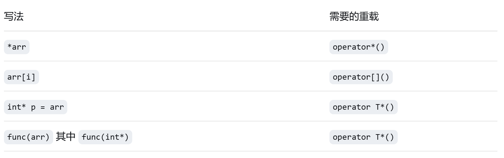

# 第九节课笔记

## 日期 4.21

### 6.1.2 函数模板常量参数化

- 相当于常量的宏替换的感觉

### 6.1.3 函数模板中的静态对象

- 每个模板实例化（T不同）有独立的静态成员；
- 同一个模板实例化（同一组模板参数）共享静态成员；

### 6.1.4 冒泡排序函数模板

- 示例略。

### 6.2 类模板（依旧前面加一行template<>）

- 成员函数若要在类模板外定义，需要加template<模板参数表>，类名后有<T等>；

### 6.2.1 类模板的常量参数化

- 类似于6.1.2；

### 6.3 数组类模板

- 解决静态数组两个局限（长度是常数、不检查越界）；
- 注意重载：
  ==注意：*与T\*重载的区别：==
  \*重载是为了对象名解引用可行；而T\*重载是一个T\*的类型转换数；
- 高维数组类：依次重载[]，返回低一维的数组类；

### 7 流类库与输入/输出

- I/O流的概念
  
  - 流类是一个类，其中包含了文件信息（指针）等，和一些操作接口，外部通过调用这些操作实现对流类对象的操作，并由流类对象进而操作文件；
  - 目的就是把对各种文件操作抽象成一个统一的类，这样形成桥接模式（抽象接口与底层实现<存储>解耦）；

### 7.1 输出流

- 最重要的三个输出流类：ostream、ofstream、ostringstream
  
  - ostream标准输出；
  - ofstream对文件输出；
  - ostringstream向字符串输出；

- 打开文件的方式：用构造函数直接打开、用open函数打开；
- new来的流类对象记得delete；

### 其他

- 用判断条件直接当返回bool的函数的返回值，提高执行效率；
